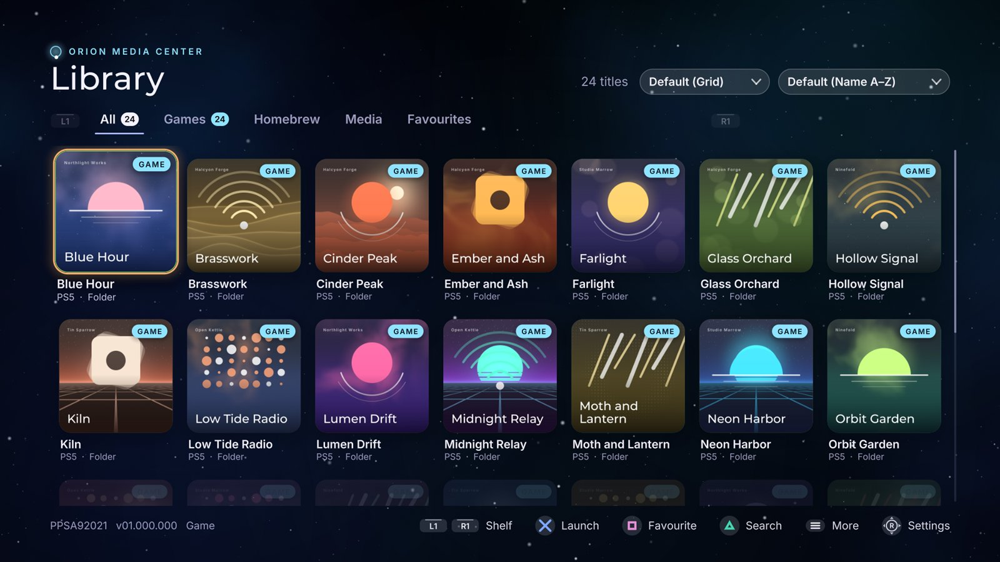
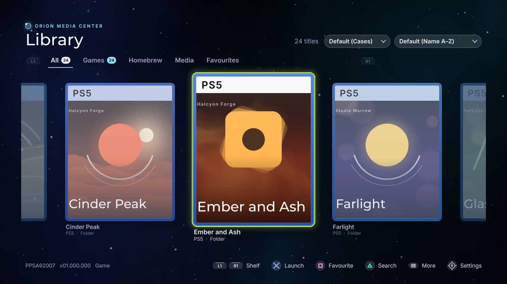
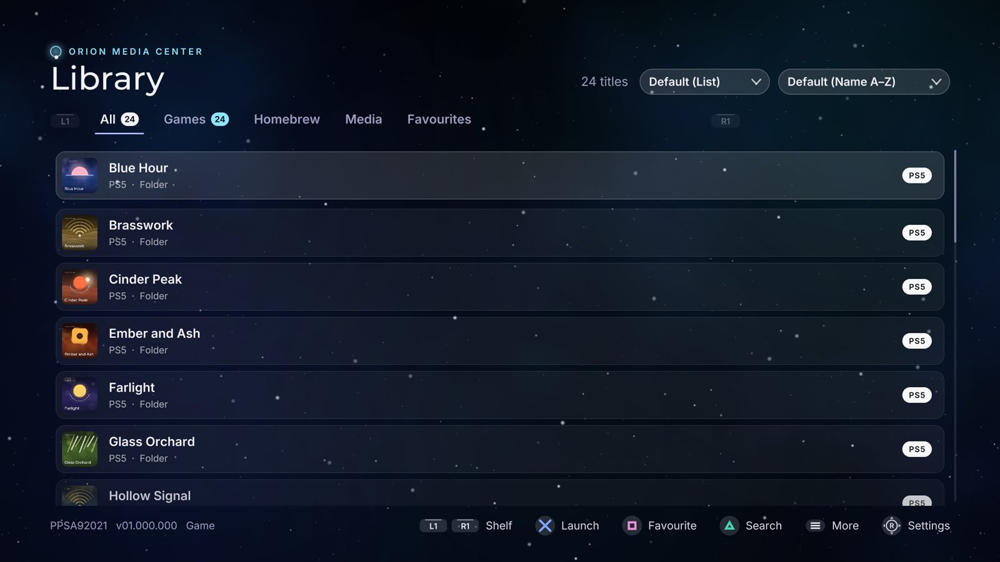
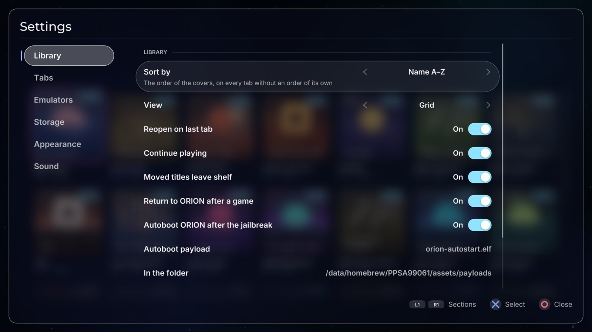
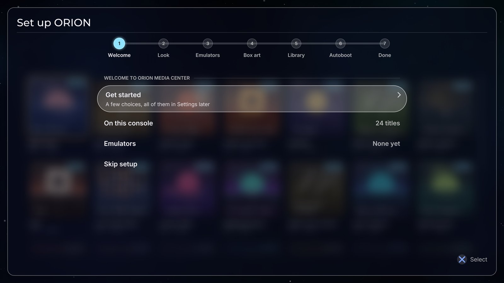

# ORION Media Center

A launcher for a jailbroken PS5: your PS5 and PS4 games, homebrew, media apps
and emulated games in one library, with box art, favourites, tabs of your own
and a galaxy glass look. Everything is driven with the controller, and
everything can be changed in Settings.

Title ID: `PPSA99061`.



## Features

**One library for everything**
- PS5 and PS4 games, homebrew and media apps, found where ShadowMountPlus
  mounts them (`/data/homebrew`, `/mnt/ext0/homebrew`, USB drives).
- Emulated games next to them: RetroArch (its folders and every playlist),
  Porpoise for GameCube and Wii, PS5SX2 for PS2, and folders of your own.
- Start a game straight from its cover: emulated games open directly in the
  emulator that plays them, and ORION asks which one when two can.
- Box art downloaded as the covers scroll into view, or taken from what
  PS5SX2 and Porpoise already downloaded.

**Three ways to look at it**

| Grid | Cases | List |
| --- | --- | --- |
|  |  |  |
| Covers, many to a screen | Big game cases with their system's band, three at a time | One row per title, quick for large collections |

Each tab keeps its own view and its own order: by name, recently added,
platform, tag (Games, Homebrew, Media, under separators), recently played or
most played.

**Yours to arrange**
- Tabs: All, Games, Homebrew, Media, Favourites, one Emulators tab with a
  row per system (or a tab per system), and tabs of your own.
- Favourites, Continue playing (what you played last, over the All tab),
  hidden titles, search.
- Play time for every game, and when you last played it.
- Remove a title from the home screen, or delete it, from ORION.

**Made for the controller**
- Every setting in one place, Settings (R3), with a first-run setup that
  walks through the look, emulators, box art and autoboot.
- Themes and a look of your own: colours, the galaxy sky, glass, corners,
  focus ring, per tab if you like.
- Background music (add your own `.ogg` files) and sound effects.
- Opens by itself after the jailbreak (autoboot), returns to ORION when a game
  closes, and tells you when a newer ORION is out.

| Settings | First-run setup |
| --- | --- |
|  |  |

The pictures show invented titles: ORION's renderer drew them on a PC
(`HUI_SHOWCASE`, see [AGENTS.md](AGENTS.md)).

## What you need

- A PS5 you own, jailbroken, with a homebrew loader that runs folder apps
  from `/data/homebrew`.
- **ShadowMountPlus**, loaded after every jailbreak. It puts ORION (and your
  other folder apps) on the home screen and starts them.
- An **ELF loader on port 9021** (the usual one that comes with the
  jailbreak). ORION starts games and removes titles through a small helper it
  sends there.
- An **FTP server on the console** (port 2121, the common `ftpsrv`): to copy
  ORION over, and optional afterwards (ORION uses it to read the pictures
  the home screen shows behind a game).

Optional, for retro games: **RetroArch**, **Porpoise** (Dolphin for PS5:
GameCube and Wii) and **PS5SX2** (PS2), installed as folder apps too.

## Install

1. Download the ORION release ZIP and extract it. It holds one folder,
   `PPSA99061`.
2. With an FTP client, upload that folder to `/data/homebrew/` on the
   console, so you have `/data/homebrew/PPSA99061/eboot.bin`.
3. Wait about ten seconds: ShadowMountPlus registers the new title, and ORION
   appears on the home screen. If it does not, run ShadowMountPlus again.
4. Open ORION. The first time, a short setup walks you through the look,
   your emulators, box art, how the library is sorted and autoboot.

If an older `PPSA99061.ffpkg` or `.ffpfsc` image is in `/data/homebrew`,
delete it first: a folder and an image with the same title ID must not both
be there.

### Updating

ORION tells you when a newer version is out: each time it opens it asks
GitHub for the latest release (Settings, Library: **Check for updates**, and
**Check now**). Releases are at
[github.com/XeN-Made/Orion-Media-Center/releases](https://github.com/XeN-Made/Orion-Media-Center/releases).

To install one, close ORION (hold Circle on the library, or close it from the PS button
menu), then upload the new `PPSA99061` folder over the old one. Your
settings, favourites and box art live in `/data/orion` and are kept.

The home screen keeps its own copy of the icon and backgrounds from the first
install. A release that changes them asks you to replace
`icon0.png`, `pic0.dds` and `pic1.dds` in `/user/app/PPSA99061/sce_sys/` and
`/user/appmeta/PPSA99061/` as well (and `/user/app/PPSA99061/icon0.png`).

## Open ORION after every jailbreak (autoboot)

ORION comes with a small payload, `orion-autostart.elf`. Your jailbreak's
autoloader sends it with the others; it waits until nothing else is in front
(the browser has closed), then opens ORION. If you start a game straight away
instead, it stays out of the way.

The payload is in the release ZIP at
`PPSA99061/assets/payloads/orion-autostart.elf` (and on the console at
`/data/homebrew/PPSA99061/assets/payloads/orion-autostart.elf`).

### With Payload Manager (pldmgr)

Most autoloaders today (Y2JB, BD-JB, Lua, the WebKit one) start **Payload
Manager**, which then loads the payloads on its own autoload list, usually
kstuff and ShadowMountPlus.

1. Copy `orion-autostart.elf` to the root of a USB drive and plug it into the
   PS5, or keep it on your PC.
2. Open Payload Manager: it opens in the PS5's browser after the jailbreak, or
   from a PC at `http://<your PS5's IP>:8084`.
3. Import the payload: from the USB drive, or upload it from the PC.
4. Open its **Autoload** list and add `orion-autostart` **last**, after
   ShadowMountPlus (ORION must be on the home screen before it can be opened).
5. Save.

On the next jailbreak the list runs, and ORION opens once nothing else is
in front. If Payload Manager is set to open its page in the browser after
autoloading (*auto browser open*), ORION opens when you close the browser;
turn that setting off and ORION opens by itself.

### With an autoloader's own list

An autoloader that reads `autoload.txt` (in a `ps5_autoloader` folder on a USB
drive or in `/data`) takes one payload per line, run in order. Put
`orion-autostart.elf` in that folder and add its name as the last line, after
ShadowMountPlus.

### Turning it off, and checking it

To stop it without touching the autoloader: Settings, Library, **Autoboot ORION
after the jailbreak**. It gives up if nothing has let it open ORION within 30
minutes. Every step it took is written to `/data/orion/autostart.txt`.

## Using it

| Button | What it does |
| --- | --- |
| Cross | Start the title |
| Square | Favourite (a star; Favourites collects them) |
| Triangle | Search |
| Options | The title's menu: move to a tab, play with another emulator, hide, remove |
| R3 | Settings |
| L1 / R1 | Change tab |
| L2 / R2 | Change system, on the Emulators tab |
| Up from the top row | The View and Sort pickers |
| Hold Circle | Close ORION |

- **Views**: Grid (covers), Cases (big game cases, three to a screen, with
  their system's band across the top) or List. Each tab can have its own.
- **Sort**: by name, recently added, platform, tag (Games, Homebrew, Media
  under separators), recently played or most played. Each tab can have its
  own.
- **Continue playing**: the titles you played last, over the All tab.
- **Tabs of your own**, a theme per tab, hidden titles: Settings, Tabs.
- **Removing a title**: Options, Remove. *Remove from home screen* takes it off
  the home screen and keeps its files; *Delete* erases its files (hold Cross
  to confirm). ORION closes while ShadowMountPlus does it, then opens again.

## Emulators and their games

Settings, Emulators, **Scan for emulators** finds RetroArch, Porpoise and
PS5SX2 and the games they can see:

- **RetroArch**: games in its own `content/<system>/` folders and every game in
  its playlists, wherever the files are.
- **Porpoise**: GameCube and Wii discs in its `porpoise/games` folder,
  `/data/porpoise/games`, `/data/games`, `/data/roms` and `/data/iso`.
- **PS5SX2**: PS2 discs (`.iso`, `.chd`, `.cso`, `.zso`) in `/data/PCSX2/games`,
  `/data/PCSX2`, and `PS2/` or `PCSX2/games/` on a drive.
- **Your own folders**: Settings, Emulators, an emulator, **Add a game folder**.

When two emulators can play a game, ORION asks which one the first time and
remembers (Options, Play with… changes it). PS2 games start straight in
PS5SX2; GameCube and Wii games straight in Porpoise; every other system in
RetroArch with the core you chose for it.

## Box art and music

- Box art downloads as the covers scroll into view and is kept in
  `/data/orion/art` (Settings, Box art, can move it to a USB drive). Covers
  PS5SX2 and Porpoise already downloaded are used as they are.
- Background music: every `.ogg` in `/data/orion/music` joins ORION's own
  tracks. Settings, Sound sets the volumes and skips a song.

## If something goes wrong

- **A game does not start**: Settings, Emulators shows what ORION found. What
  happened at each start is in `/data/orion/launch.txt` and
  `/data/homebrew/PPSA99061/launch-helper.txt`.
- **ORION does not open after rest mode**: restart the console (not rest
  mode) and jailbreak again; a jailbreak does not survive rest mode well.
- **Start-up**: each step is noted in `/data/orion/boot.txt`.
- **Start over**: delete `/data/orion/library.json` and ORION runs its setup
  again, keeping your box art.

Please include those files when you report a problem.

## Building it yourself

ORION builds on Linux or WSL. [AGENTS.md](AGENTS.md) is the quick tour of the
repository (it is written for coding agents, and works for people in a
hurry); [docs/platform/GETTING_STARTED.md](docs/platform/GETTING_STARTED.md)
sets up the tools.

```bash
make test-unit      # the tests
make                # the PS5 app folder, in dist/PPSA99061
make deploy         # upload it to the console over FTP (PS5_HOST in .env)
```

## Credits and licence

ORION Media Center is built on
[ps5-homebrew-ui](https://github.com/blackbearreloaded/ps5-homebrew-ui) by
BlackBearReloaded, whose kit draws everything on screen; its overview is in
[docs/UI_KIT.md](docs/UI_KIT.md). Third-party code, fonts and sounds are
listed in [THIRD_PARTY_NOTICES.md](THIRD_PARTY_NOTICES.md).

Licensed under the GNU General Public License v3.0 or later
([LICENSE](LICENSE)).
