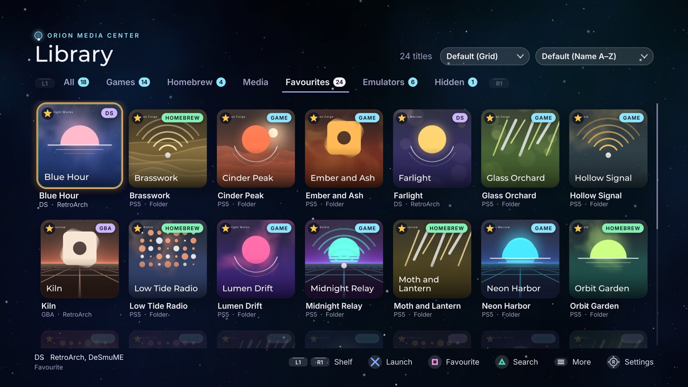

# ORION Media Center

A launcher for a jailbroken PS5: your PS5 and PS4 games, homebrew, media apps
and emulated games in one library, with box art, favourites, tabs of your own
and a galaxy glass look. Everything is driven with the controller, and
everything can be changed in Settings.

Title ID: `PPSA99062` (`PPSA99061` before 01.103.000). Questions, ideas and
bug reports: the [ORION Discord](https://discord.gg/SS7N7ukzQv).


## Features

**One library for everything**
- PS5 and PS4 games, homebrew and media apps, found where ShadowMountPlus
  mounts them (`/data/homebrew`, `/mnt/ext0/homebrew`, USB drives), and
  everything else on the home screen: installed PS4 and PS5 packages, and
  images ShadowMountPlus mounted from anywhere (exFAT images included).
- Emulated games next to them: RetroArch (its folders and every playlist),
  Porpoise for GameCube and Wii, PS5SX2 for PS2, PSwanStation for PS1,
  ProsperoEden for Switch, PS5-ECAM for Wii U, 3DS, DS and Switch, PS5X360 for
  Xbox 360, and folders of your own.
- Start a game straight from its cover: emulated games open directly in the
  emulator that plays them, and ORION asks which one when two can.
- Box art downloaded as the covers scroll into view, or taken from what
  the emulators already downloaded.



*One tab, every kind of title: PS5 games, homebrew, and DS and GBA games, each
started with Cross, the emulated ones straight in their emulator.*

**Three ways to look at it**

| Grid | Cases | List |
| --- | --- | --- |
|  |  |  |
| Covers, many to a screen | Big game cases with their system's band, three at a time | One row per title, quick for large collections |

Each tab keeps its own view and its own order: by name, recently added,
platform, tag (Games, Homebrew, Media, under separators), recently played or
most played.

**Yours to arrange**
- Tabs: All, Games, Homebrew, Media, Favourites, one Emulators tab with a
  row per system (or a tab per system), and tabs of your own.
- Favourites, Continue playing (what you played last, over the All tab),
  hidden titles, search.
- Play time for every game, and when you last played it.
- Remove a title from the home screen, or delete it, from ORION.

**Made for the controller**
- Every setting in one place, Settings (R3), with a first-run setup that
  walks through the language, the look, emulators, box art and autoboot.
- In English, Spanish, Portuguese (Brazil) or Hungarian, following the console's language
  or the one you pick; other languages can be added as files.
- Themes and a look of your own: colours, the galaxy sky, glass, corners,
  focus ring, per tab if you like.
- Background music (add your own `.ogg` files) and sound effects.
- Opens by itself after the jailbreak if you like (autoboot, off until you turn
  it on), returns to ORION when a game closes, and updates itself when a newer
  ORION is out.

| Settings | First-run setup |
| --- | --- |
|  |  |

The pictures show invented titles: ORION's renderer drew them on a PC
(`HUI_SHOWCASE`, see [AGENTS.md](AGENTS.md)).

## What you need

- A PS5 you own, jailbroken, with a homebrew loader that runs folder apps
  from `/data/homebrew`.
- **ShadowMountPlus**, loaded after every jailbreak. It puts ORION (and your
  other folder apps) on the home screen and starts them.
- An **ELF loader on port 9021** (the usual one that comes with the
  jailbreak). ORION starts games and removes titles through a small helper it
  sends there.
- An **FTP server on the console** (port 2121, the common `ftpsrv`): to copy
  ORION over, and optional afterwards (ORION uses it to read the pictures
  the home screen shows behind a game).

Optional, for retro games: **RetroArch**, **Porpoise** (Dolphin for PS5:
GameCube and Wii), **PS5SX2** (PS2), **PSwanStation** (PS1),
**ProsperoEden** (Switch), **PS5-ECAM** (Wii U, 3DS, DS and Switch) and
**PS5X360** (Xbox 360), installed as folder apps too. Installed games beyond
the homebrew folders are read through the FTP server.

## Install

1. Download the ORION release ZIP and extract it. It holds one folder,
   `PPSA99062`.
2. With an FTP client, upload that folder to `/data/homebrew/` on the
   console, so you have `/data/homebrew/PPSA99062/eboot.bin`. Copy the
   folder whole, every file as it is, with a plain FTP client (binary
   mode); some upload tools leave out files they do not expect in an app,
   such as the `.txt` files ORION reads.
3. Wait about ten seconds: ShadowMountPlus registers the new title, and ORION
   appears on the home screen. If it does not, run ShadowMountPlus again.
4. Open ORION. The first time, a short setup walks you through the look,
   your emulators, box art, how the library is sorted and autoboot.

If an older `PPSA99062.ffpkg` or `.ffpfsc` image is in `/data/homebrew`,
delete it first: a folder and an image with the same title ID must not both
be there.

### Coming from PPSA99061

ORION's title ID changed from `PPSA99061` to `PPSA99062` in 01.103.000 (the
ID it has in the RecompStore). An ORION on 01.102.000 tells you, downloads
01.103.000 like any update and installs it **beside** itself: a second ORION
tile appears, with a small NEW badge. Open the new one; your settings,
favourites, box art and music live in `/data/orion` and come along. Then
delete the old one from the new ORION: Options on its tile (`PPSA99061`),
Delete. Nothing is deleted for you.

On an older ORION, install 01.103.000 by hand as above: upload the
`PPSA99062` folder next to the old one, then delete the old one. Autoboot
follows by itself (the payload asks ORION which title to open), but if your
autoloader names the payload by its path, point it at the new folder.

### Updating

ORION updates itself. Each time it opens it asks GitHub for the latest
release; when there is a newer one it says so (a notification), downloads
it in the background with its progress at the top right, checks it against
the release's published SHA256 sum, and asks: **Update now** closes ORION,
puts the new files in place, and opens it again. Your settings, favourites
and box art stay. Keep ORION open while it downloads.

The files an update replaced are kept in `/data/orion/update/previous`, the
way back to the version before. Every step is written to
`/data/orion/update/log.txt`.

Settings, **About** shows the version you have and has the update
controls: **Check now**, **Install ORION …** once one is ready, **Check for
updates** and **Download updates by themselves**. Releases are at
[github.com/XeN-Made/Orion-Media-Center/releases](https://github.com/XeN-Made/Orion-Media-Center/releases).

To install one by hand instead, close ORION (hold Circle on the library, or
close it from the PS button menu), then upload the new `PPSA99062` folder
over the old one. Your
settings, favourites and box art live in `/data/orion` and are kept.

The home screen keeps its own copy of the icon and backgrounds from the first
install. A release that changes them asks you to replace
`icon0.png`, `pic0.dds` and `pic1.dds` in `/user/app/PPSA99062/sce_sys/` and
`/user/appmeta/PPSA99062/` as well (and `/user/app/PPSA99062/icon0.png`).

## Open ORION after every jailbreak (autoboot)

ORION comes with a small payload, `orion-autostart.elf`. Your jailbreak's
autoloader sends it with the others; it waits until nothing else is in front
(the browser has closed), then opens ORION. If you start a game straight away
instead, it stays out of the way.

Autoboot is **off** until you turn it on: in the first-run setup, or later in
Settings, Library, **Autoboot ORION after the jailbreak**. Then add the payload
to your autoloader as below.

The payload is in the release ZIP at
`PPSA99062/assets/payloads/orion-autostart.elf` (and on the console at
`/data/homebrew/PPSA99062/assets/payloads/orion-autostart.elf`).

### With Payload Manager (pldmgr)

Most autoloaders today (Y2JB, BD-JB, Lua, the WebKit one) start **Payload
Manager**, which then loads the payloads on its own autoload list, usually
kstuff and ShadowMountPlus.

1. Copy `orion-autostart.elf` to the root of a USB drive and plug it into the
   PS5, or keep it on your PC.
2. Open Payload Manager: it opens in the PS5's browser after the jailbreak, or
   from a PC at `http://<your PS5's IP>:8084`.
3. Import the payload: from the USB drive, or upload it from the PC.
4. Open its **Autoload** list and add `orion-autostart` **last**, after
   ShadowMountPlus (ORION must be on the home screen before it can be opened).
5. Save.

On the next jailbreak the list runs, and ORION opens once nothing else is
in front. If Payload Manager is set to open its page in the browser after
autoloading (*auto browser open*), ORION opens when you close the browser;
turn that setting off and ORION opens by itself.

### With an autoloader's own list

An autoloader that reads `autoload.txt` (in a `ps5_autoloader` folder on a USB
drive or in `/data`) takes one payload per line, run in order. Put
`orion-autostart.elf` in that folder and add its name as the last line, after
ShadowMountPlus.

### Turning it on or off, and checking it

Settings, Library, **Autoboot ORION after the jailbreak** turns it on or off
without touching the autoloader. It gives up if nothing has let it open ORION
within 30 minutes. Every step it took is written to
`/data/orion/autostart.txt`.

## Using it

| Button | What it does |
| --- | --- |
| Cross | Start the title |
| Square | Favourite (a star; Favourites collects them) |
| Triangle | Search |
| Options | The title's menu: rename, move to a tab, play with another emulator, hide, remove |
| R3 | Settings |
| L1 / R1 | Change tab |
| L2 / R2 | Change system, on the Emulators tab |
| Up from the top row | The View and Sort pickers |
| Hold Circle | Close ORION |

- **Views**: Grid (covers), Cases (big game cases, three to a screen, with
  their system's band across the top) or List. Each tab can have its own.
- **Sort**: by name, recently added, platform, tag (Games, Homebrew, Media
  under separators), recently played or most played. Each tab can have its
  own.
- **Continue playing**: the titles you played last, over the All tab.
- **Tabs of your own**, a theme per tab, hidden titles: Settings, Tabs.
  Every tab, the built-in ones too (All, Games, Emulators, each system), can
  be **renamed** or **hidden** from its page there.
- **Wide covers**: give a tab the Landscape cover shape (Settings, Tabs, its
  page) and console games show their 16:9 home-screen picture, made small
  once in `/data/orion/wide`.
- **Open ORION after rest mode** (Settings, Library): when the console wakes
  on the home screen, ORION opens; a game left running stays in front.
- **FTP**: everything in `/data/orion` is open to your FTP server, to add
  pictures, music and keys or to delete the folder.
- **Renaming a title**: Options, Rename. Clear the name to give it its own back.
- **Themes of your own**: a `.theme` text file in `/data/orion/themes/`;
  [docs/ORION_THEMES.md](docs/ORION_THEMES.md) has every key and
  [template.theme](docs/themes/template.theme) to start from.
- **Language**: Settings, Library, Language (or the first step of the setup).
  *Automatic* follows the console. To add or correct a language, copy
  [template.lang](docs/lang/template.lang) to `/data/orion/lang/<code>.lang`,
  fill in the translations and open ORION again; a file there replaces ORION's
  own of the same code, and text left empty shows in English.
- **Removing a title**: Options, Remove. *Remove from home screen* takes it off
  the home screen and keeps its files; *Delete* erases its files (hold Cross
  to confirm). ORION closes while ShadowMountPlus does it, then opens again.

## Emulators and their games

Settings, Emulators, **Scan for emulators** finds RetroArch, Porpoise,
PS5SX2, PSwanStation, ProsperoEden, PS5-ECAM and PS5X360 and the games they
can see:

- **RetroArch**: games in its own `content/<system>/` folders and every game in
  its playlists, wherever the files are.
- **Porpoise**: GameCube and Wii discs in its `porpoise/games` folder,
  `/data/porpoise/games`, `/data/games`, `/data/roms` and `/data/iso`.
- **PS5SX2**: PS2 discs (`.iso`, `.chd`, `.cso`, `.zso`) in `/data/PCSX2/games`,
  `/data/PCSX2`, and `PS2/` or `PCSX2/games/` on a drive.
- **PSwanStation**: PS1 discs (`.chd`, `.cue`, `.iso`, `.img`, `.pbp`, `.ecm`,
  `.mds`) in its `games` folder and, with its "USB drives" setting on, a
  `psx`, `ps1` or `playstation` folder at the top of a drive. A game on
  several discs shows once. Its covers are used.
- **ProsperoEden**: Switch games (`.xci`, `.nsp`, `.nro`) in the game folder
  set in its settings and in `/data/prosperoeden/roms`. Its covers are used.
- **PS5-ECAM**: every game in its own library (Wii U, 3DS, DS and Switch), and
  the games folders set in its Settings: Wii U games as `.wua`, `.wud`, `.wux`,
  `.rpx` or a folder of NUS files (`title.tmd`), 3DS as `.3ds`, `.cci`, `.cia`,
  `.cxi`, `.3dsx`, DS as `.nds` or `.zip`, Switch as `.xci`, `.nsp`, `.nro`.
- **PS5X360**: Xbox 360 games in its `assets/roms` folder, `/data/xbox360` and
  `xbox360/` on a drive: a folder per extracted game (`default.xex`) and `.iso`
  discs. A `cover.png` or `cover.jpg` in a game's folder, or a picture named as
  the disc beside it, is its cover.
- **Your own folders**: Settings, Emulators, an emulator, **Add a game folder**.

A full ROM set holds many files of one game: bad dumps, hacks, trainers,
translations, other regions. ORION shows each RetroArch game once, the best
file of it (a verified dump from the USA first). Settings, Emulators, **Every
version of a game** shows them all.

When two emulators can play a game, ORION asks which one the first time and
remembers (Options, Play with… changes it). PS2 games start straight in
PS5SX2; GameCube and Wii games straight in Porpoise; PS1 games in
PSwanStation or RetroArch; Switch games in ProsperoEden or PS5-ECAM; Wii U and
3DS games straight in PS5-ECAM; Xbox 360 games straight in PS5X360; every other system in RetroArch with the core
you chose for it.

## Box art and music

- Box art downloads as the covers scroll into view and is kept in
  `/data/orion/art` (Settings, Box art, can move it to a USB drive). Covers
  the emulators already downloaded are used as they are.
  RetroArch's systems get theirs from the libretro thumbnail sets; Switch,
  Wii U, 3DS and DS games from GameTDB (Switch games are matched by name).
- Games mounted from disc images show the home screen's sharp 512-pixel
  picture (copied once into `/data/orion/icons`) instead of ShadowMountPlus's
  small one.
- Options on a title: **Download HD picture** (console games) or **Download
  box art again** (emulated games) fetches its picture afresh.
- **Your own pictures**: Options on a title, **Choose picture…**, browses your
  drives for a PNG or JPEG. Or drop one into `/data/orion/custom-art` named
  after the game (`Chrono Trigger.png`) or its title ID (`PPSA01234.jpg`);
  case and punctuation do not matter. **Use its own picture** puts the
  original back.
- **SteamGridDB**: with a key of your own (free: steamgriddb.com, your
  profile, Preferences, API), games no other source has a cover for get one
  from SteamGridDB, and Options on any title, **Find other art…**, shows up to
  eight covers on the tile: Left and Right to look, Cross keeps one, Circle
  puts the old one back. Enter the key in Settings, Box art, or put a line
  `steamgriddb = <your key>` in `/data/orion/keys.txt`.
- Background music: every `.ogg` in `/data/orion/music` joins ORION's own
  tracks. Settings, Sound sets the volumes and skips a song.
- **Title music**: rest the focus on a game and its own home-screen music
  plays over ORION's, as on the PS5's home screen. Options on a title,
  **Choose music…**, picks an `.ogg` (or `.at9`) of yours instead; or drop
  one into `/data/orion/hover-music` named after the game or its title ID.
  Settings, Sound, **Title music** turns it off.

## Anonymous usage

To know how many consoles use it, ORION checks in when it opens and then every
five minutes while it stays open. This is all of it:

```json
{"id": "3f9c0d27a1b84e6c9d5e2f7a8b1c4d03", "version": "01.104.000"}
```

- **`id`**: 32 random characters, made once on your console and kept in
  `/data/orion/usage-id.txt`. It is not your console's ID, your account or
  anything taken from them. Delete the file and ORION makes a new one.
- **`version`**: the ORION version you run.

Nothing else is sent: no account, no games, no play times, no console details.
The counter ([stats/worker](stats/worker)) keeps the ID, the version, when it
last checked in and the days it did. It does not keep IP addresses, and it
deletes everything older than 400 days. What ORION sent last, when and where
to, is in `/data/orion/usage.txt`.

It is on unless you turn it off: Settings, Library, **Share anonymous usage**.

## If something goes wrong

Ask on the [ORION Discord](https://discord.gg/SS7N7ukzQv), or report a bug there in
**#bug-reports** with your ORION version (Settings, About), what you did, what
happened, and the log the list below names.

- **A game does not start**: Settings, Emulators shows what ORION found. What
  happened at each start is in `/data/orion/launch.txt` and
  `/data/orion/launch-helper.txt` (or `launch-helper.txt` in ORION's own
  folder, `/data/homebrew/PPSA99062`, when the helper cannot write there).
- **ORION does not open after rest mode**: restart the console (not rest
  mode) and jailbreak again; a jailbreak does not survive rest mode well.
- **An update does not finish**: `/data/orion/update/log.txt` has each step,
  and `/data/orion/launch-helper.txt` what the install did.
  A version that failed to install is not downloaded again by itself:
  Settings, About, **Check now** tries again.
- **Start-up**: each step is noted in `/data/orion/boot.txt`.
- **Start over**: delete `/data/orion/library.json` and ORION runs its setup
  again, keeping your box art.

Please include those files when you report a problem.

## Building it yourself

ORION builds on Linux or WSL. [AGENTS.md](AGENTS.md) is the quick tour of the
repository (it is written for coding agents, and works for people in a
hurry); [docs/platform/GETTING_STARTED.md](docs/platform/GETTING_STARTED.md)
sets up the tools.

```bash
make test-unit      # the tests
make                # the PS5 app folder, in dist/PPSA99062
make deploy         # upload it to the console over FTP (PS5_HOST in .env)
```

## Credits and licence

ORION Media Center is built on
[ps5-homebrew-ui](https://github.com/blackbearreloaded/ps5-homebrew-ui) by
BlackBearReloaded, whose kit draws everything on screen; its overview is in
[docs/UI_KIT.md](docs/UI_KIT.md). Third-party code, fonts and sounds are
listed in [THIRD_PARTY_NOTICES.md](THIRD_PARTY_NOTICES.md).

Licensed under the GNU General Public License v3.0 or later
([LICENSE](LICENSE)).
